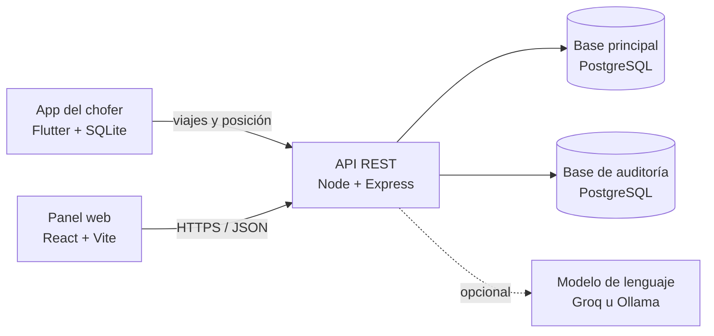

# 🚖 Radio Taxis Pulpos: sistema de tarificación

[](https://github.com/BenjexDtz/pulpos-taxis/actions/workflows/ci.yml)
[](https://github.com/BenjexDtz/pulpos-taxis/releases/latest)

En El Alto, muchas carreras de radio taxi se cobran de palabra. Este sistema calcula la tarifa con la distancia, el tiempo y el tipo de calle (asfalto, tierra o empedrado), y permite a la empresa comprobar después cada cobro.

Una sola instalación atiende a varias empresas, con sus datos aislados entre sí.

> Proyecto de Taller de Grado · Universidad Salesiana de Bolivia · Boris Benjamín Barboza Lima

**Contenido:** [Qué hace](#qué-hace) · [Arquitectura](#arquitectura) · [Puesta en marcha](#puesta-en-marcha) · [Cuentas de demostración](#cuentas-de-demostración) · [Cálculo de la tarifa](#cálculo-de-la-tarifa) · [Seguridad](#seguridad) · [Pruebas](#pruebas) · [API](#api) · [Estructura](#estructura-del-repositorio) · [Documentación](#documentación)

## Qué hace

**App del chofer (Android)**
- Taxímetro con GPS que funciona sin internet y envía los viajes cuando vuelve la conexión.
- Recupera el viaje en curso si la app se cierra.
- Mide la vibración del vehículo y sugiere cambiar la superficie marcada; la decisión siempre es del chofer.
- Incluye un modo demostración que simula un recorrido sin contar en los totales.

**Panel de la empresa (web)**
- Central con el resumen del día, el mapa de la flota y la bitácora de viajes.
- Informes, administración de choferes, tarifa propia de cada empresa y ruta de cada viaje.
- Asistente de IA para consultar los datos en lenguaje natural.

**Servidor**
- Recalcula cada viaje con su ruta y marca los que no cuadran, sin rechazarlos porque el pasajero ya pagó.
- No duplica un viaje aunque la app lo reenvíe.
- Guarda una bitácora de auditoría en una base de datos separada, que detecta alteraciones.

## Arquitectura



| Carpeta | Tecnología | Función |
|---|---|---|
| `pulpos_backend/` | Node 22+, Express 5, `pg`, JWT | API REST |
| `pulpos_web_admin/` | React 19, Vite 8, Tailwind 4, Recharts | Panel de administración |
| `pulpos_apk/` | Flutter (Dart ^3.11) | Taxímetro para Android |
| `database/` | PostgreSQL 16 o superior | Esquema, migraciones y base de auditoría |

## Puesta en marcha

### Opción 1: Docker

Requiere Docker Desktop. Levanta las dos bases de datos, el backend y el panel:

```bash
git clone https://github.com/BenjexDtz/pulpos-taxis.git
cd pulpos-taxis
cp .env.example .env    # cambia las claves antes de usarlo fuera de tu equipo
docker compose up --build
```

- **Panel:** http://localhost:8080
- **API:** http://localhost:3000

`docker compose down` lo detiene. Con `docker compose down -v` también se borran las bases de datos.

### Opción 2: sin Docker

Requiere Node 22+ y PostgreSQL 16 o superior.

**1. Bases de datos**

```bash
psql -U postgres -c "CREATE DATABASE pulpos_db;"
psql -U postgres -d pulpos_db -f database/init.sql

psql -U postgres -c "CREATE DATABASE pulpos_auditoria;"
psql -U postgres -d pulpos_auditoria -f database/auditoria/esquema.sql
psql -U postgres -d pulpos_auditoria -v clave_auditor='UNA_CLAVE_SEGURA' -f database/auditoria/rol_app.sql
```

**2. Backend** (puerto 3000)

```bash
cp .env.example pulpos_backend/.env
cd pulpos_backend
npm install
npm start
```

Antes de arrancarlo, ajusta en `pulpos_backend/.env`:
- `DB_HOST=localhost` y tus credenciales de PostgreSQL.
- `AUDIT_DB_PASSWORD` con la clave que elegiste para `auditor_app`.
- `JWT_SECRET` con 32 caracteres aleatorios o más.

**3. Panel** (puerto 5173)

```bash
cd pulpos_web_admin
echo "VITE_API_URL=http://localhost:3000" > .env
npm install
npm run dev
```

**¿Ya tienes una base de una versión anterior?** No ejecutes `init.sql`. Haz un respaldo y aplica en orden los archivos que te falten de `database/migraciones/`, por ejemplo:

```bash
psql -1 -U postgres -d pulpos_db -f database/migraciones/014_placas_sin_guion.sql
```

### App móvil

Puedes instalar el APK de la [última versión publicada](https://github.com/BenjexDtz/pulpos-taxis/releases/latest), pero ese APK apunta al servidor configurado al compilarlo. Para usar tu propio backend, compílala con su URL:

```bash
cd pulpos_apk
flutter pub get
flutter run --dart-define=API_URL=https://tu-tunel.ngrok-free.dev
flutter build apk --dart-define=API_URL=https://tu-tunel.ngrok-free.dev
```

Android 9 o superior bloquea `http://` sin cifrar, así que usa una URL `https` (por ejemplo, con ngrok).

### Asistente de IA (opcional)

Define `LLM_API_KEY` en el `.env`; sin esa clave, el resto del sistema funciona igual y solo el asistente queda desactivado. Usa Groq por defecto y también admite Ollama local (revisa `.env.example`).

## Cuentas de demostración

Las crea `init.sql`, solo para pruebas. **Cámbialas antes de cualquier despliegue real.**

**Panel web**

| Rol | Correo | Contraseña | Alcance |
|---|---|---|---|
| Superadmin | `superadmin@plataforma.bo` | `password` | Plataforma y todas las empresas |
| Gerente | `admin@pulpos.bo` | `password` | Radio Taxis Pulpos |
| Gerente | `admin@illimani.bo` | `password` | Radio Taxis Illimani |

En el primer ingreso se escanea un QR con una app autenticadora, como Google Authenticator o Aegis.

**App móvil**

| Empresa | Placa | Contraseña |
|---|---|---|
| `pulpos` | `1234KKK` | `123` |
| `illimani` | `5678ILL` | `123` |

Estas contraseñas son más cortas de lo permitido a propósito: son datos de demostración. Las contraseñas nuevas de choferes exigen al menos 8 caracteres.

## Cálculo de la tarifa

El taxímetro adapta el **modo de cálculo S** de la Directiva 2014/32/UE (Anexo IX) y añade un factor por el tipo de calle. Cada tramo GPS se cobra por distancia o por tiempo, lo que resulte mayor:

```
cobro del tramo = max(d × F × Tkm, t × Th)
T = B + S × ⌊ Σ cobro de los tramos / S ⌋
```

| Símbolo | Significado | Demostración |
|---|---|---|
| `d`, `t` | Distancia (km) y tiempo (h) del tramo | Medidos |
| `F` | Factor de superficie: asfalto, tierra, empedrado | 1 / 2,5 / 2 |
| `Tkm` | Tarifa por km: `Cb + Cl × Pc` | 2,696 Bs/km |
| `Th` | Tarifa por hora: `60 × Ct` | 30 Bs/h |
| `B` | Bajada de bandera | 2,00 Bs |
| `S` | Valor del salto: el importe avanza de S en S | 0,50 Bs |

Ejemplos con los valores de demostración:

| Viaje | Cálculo | Tarifa |
|---|---|---|
| 5 km en asfalto, sin detenerse | 2 + saltos de 13,48 | **15,00 Bs** |
| 5 km en empedrado, sin detenerse | 2 + saltos de 26,96 | **28,50 Bs** |
| 5 km en tierra, sin detenerse | 2 + saltos de 33,70 | **35,50 Bs** |
| 10 min detenido | 2 + saltos de 5,00 | **7,00 Bs** |

Estos valores **todavía no son una tarifa real**: deben calibrarse con mediciones en El Alto. Además, el sistema adopta el modo de cálculo de la Directiva, pero no cuenta con su certificación metrológica, porque mide con el GPS del teléfono.

La app y el servidor usan el mismo algoritmo con aritmética entera, de modo que llegan al mismo importe al centavo. El detalle, las decisiones y las limitaciones están en [`docs/MODELO_CALCULO.md`](docs/MODELO_CALCULO.md).

## Seguridad

| Aspecto | Cómo se resuelve |
|---|---|
| **Aislamiento entre empresas** | La empresa sale siempre del token, nunca de la petición. Una clave foránea impide registrar un viaje con un chofer de otra empresa. |
| **Segundo factor** | TOTP obligatorio en el panel, con secreto cifrado (AES-256-GCM), códigos de respaldo y bloqueo tras 5 fallos. |
| **Sesiones** | Cada petición consulta la base de datos: desactivar a un usuario o una empresa corta el acceso al instante. |
| **Inicio de sesión** | Máximo de 10 fallos cada 15 minutos por IP. |
| **Auditoría** | Base separada, solo inserción, cadena SHA-256 y anclas en la base principal. Si no está disponible, los eventos esperan en una cola. |
| **Asistente de IA** | El modelo nunca escribe SQL: elige entre consultas fijas, parametrizadas y filtradas por empresa. |

Los choferes no usan segundo factor: cada cuenta solo alcanza sus propios datos, el servidor verifica sus viajes y la app debe funcionar sin conexión.

## Pruebas

```bash
# Backend
cd pulpos_backend
npm test                     # unitarias, con base de datos falsa en memoria
PG_INTEGRACION=1 npm test    # además, integración en bases temporales

# Panel
cd pulpos_web_admin
npm run lint
npm run build

# App
cd pulpos_apk
flutter analyze
flutter test
```

El panel no tiene pruebas automatizadas de interfaz; se valida con lint y build. En la app, las pruebas cubren sobre todo la lógica de cálculo y sincronización. Las pantallas, el GPS y el almacenamiento local requieren pruebas en un dispositivo real.

GitHub Actions ejecuta todo esto en cada push, junto con `npm audit` del backend.

## API

<details>
<summary>Ver las rutas</summary>

**Públicas**

| Método | Ruta | Descripción |
|---|---|---|
| `GET` | `/` | Estado del servidor |
| `GET` | `/api/empresas/:codigo` | Identidad pública de una empresa |
| `POST` | `/api/login` | Login del chofer: empresa, placa y contraseña |
| `POST` | `/api/admin/login` | Primer paso del login del panel |

**Segundo factor** (con el token temporal del primer paso)

| Método | Ruta | Descripción |
|---|---|---|
| `POST` | `/api/admin/mfa/configurar` | Genera el secreto y el QR |
| `POST` | `/api/admin/mfa/activar` | Activa el factor y entrega los códigos de respaldo |
| `POST` | `/api/admin/mfa/verificar` | Valida el código y abre la sesión |

**App del chofer**

| Método | Ruta | Descripción |
|---|---|---|
| `POST` | `/api/posicion` | Envía la posición GPS |
| `POST` | `/api/viajes/sincronizar` | Envía un viaje con su ruta |
| `GET` | `/api/config` | Empresa y tarifa (también para el panel) |

**Panel de la empresa**

| Método | Ruta | Descripción |
|---|---|---|
| `GET` | `/api/admin/viajes` | Viajes, con filtro opcional por fecha |
| `GET` | `/api/admin/viajes/:id/ruta` | Ruta y verificación de un viaje |
| `GET` | `/api/admin/viajes/exportar` | Exporta los viajes a CSV |
| `GET` | `/api/admin/estadisticas` | Datos de los informes |
| `GET`, `POST` | `/api/admin/choferes` | Lista y registra choferes |
| `PUT` | `/api/admin/choferes/:id` | Corrige el nombre y la placa |
| `PATCH` | `/api/admin/choferes/:id/password` | Restablece la contraseña |
| `PATCH` | `/api/admin/choferes/:id/estado` | Activa o desactiva |
| `PUT` | `/api/admin/parametros` | Edita la tarifa |
| `POST` | `/api/admin/asistente` | Pregunta al asistente de IA |
| `GET` | `/api/admin/auditoria` | Bitácora de la empresa |
| `GET` | `/api/admin/mfa` | Estado del segundo factor |
| `POST` | `/api/admin/mfa/respaldo` | Regenera los códigos de respaldo |

**Plataforma** (superadmin)

| Método | Ruta | Descripción |
|---|---|---|
| `GET`, `POST` | `/api/plataforma/empresas` | Lista y crea empresas |
| `PUT` | `/api/plataforma/empresas/:id` | Edita una empresa |
| `PATCH` | `/api/plataforma/empresas/:id/estado` | Activa o desactiva una empresa |
| `GET` | `/api/plataforma/administradores` | Lista los administradores |
| `POST` | `/api/plataforma/administradores/:id/mfa/restablecer` | Restablece el segundo factor de otro administrador |
| `GET` | `/api/plataforma/auditoria` | Bitácora de todas las empresas |
| `GET` | `/api/plataforma/auditoria/verificar` | Verifica la integridad de la bitácora |

</details>

## Estructura del repositorio

```
pulpos-taxis/
├── pulpos_backend/            API REST (Node + Express)
│   ├── index.js               Arranque del servidor
│   ├── app.js                 Configuración y orden de rutas
│   ├── asistente.js           Asistente de IA
│   ├── auditoria.js           Registro de eventos
│   ├── mfa.js                 Segundo factor (TOTP)
│   ├── verificacion.js        Recálculo de cada viaje
│   ├── validacion.js          Validación de datos
│   ├── middlewares/           Autenticación y límite de intentos de login
│   ├── rutas/                 Un archivo por área de la API
│   └── test/                  Pruebas unitarias y de integración
├── pulpos_web_admin/          Panel web (React + Vite)
│   └── src/
│       ├── App.jsx            Sesión, rutas y carga de datos
│       ├── vistas/            Central, Informes, Flota, Parámetros y otras
│       ├── componentes/       Login, mapa, asistente y otros
│       └── contexto/          Tema claro y oscuro
├── pulpos_apk/                App del chofer (Flutter)
│   ├── lib/
│   │   ├── main.dart          Pantalla principal del taxímetro
│   │   ├── taximetro.dart     Cálculo de la tarifa
│   │   ├── motor_gps.dart     Lectura del GPS
│   │   ├── rugosidad.dart     Vibración y sugerencia de superficie
│   │   ├── base_datos.dart    Almacenamiento local (SQLite)
│   │   └── sincronizador.dart Envío de viajes al servidor
│   └── test/                  Pruebas de la app
├── database/
│   ├── init.sql               Esquema principal y datos semilla
│   ├── migraciones/           Actualización de bases existentes
│   └── auditoria/             Base de auditoría separada
├── diseno/                    Diagramas UML y figuras
└── docs/                      Modelo de cálculo
```

## Documentación

- [Modelo de cálculo](docs/MODELO_CALCULO.md): fórmula, decisiones y limitaciones.
- [Registro de cambios](CHANGELOG.md): novedades de cada versión.
- [Diagramas UML](diseno/uml): casos de uso, secuencia, clases, base de datos y despliegue.
- [`CLAUDE.md`](CLAUDE.md): guía técnica detallada de la arquitectura.
